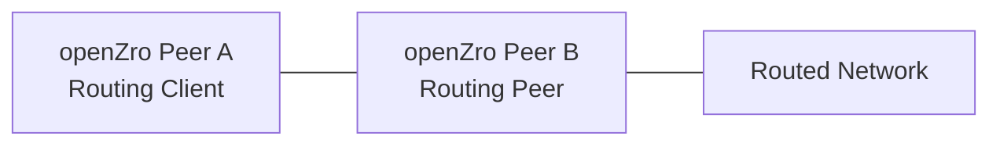

# Configuring Routes with Access Control

By default, network routes allow unrestricted access when no access control groups are assigned. When you assign access control groups to a route, only traffic that matches the defined policies can access the routed network.

## How Route Access Policies Work

Route access policies are unidirectional and apply only from routing clients to routing peers. The access control group takes effect only when used as a destination group in a policy, and the policy's source peers must also be in the route's distribution groups to receive the route.

If you assign an empty group (one containing no peers) as the access control group, only the routed network is affected by the policy, not the routing peer itself.

<Note>
    If you assign an access control group to a route but no route access policies exist or are enabled, all routed traffic will be dropped. This differs from routes without an access control group, which permit all traffic.
</Note>

## Creating a Network Route with Access Control

Go to **Network Routes** and click **Add Route**. In this example (see [Key Concepts](/manage/network-routes#key-concepts) for field descriptions):

1. **Route** tab: network range `10.10.0.0/16`, routing peer `aws-eu-router-az-a`. Click **Continue**.
2. **Groups** tab: **Distribution Groups** `devs`, **Access Control Groups** `servers`. Click **Continue**.

    

3. **Name & Description** tab: **Network Identifier** `office-servers`. Click **Continue**.
4. **Additional Settings** tab: keep the defaults and click **Add Route**.

Because the route has an access control group, the dashboard asks whether to create a policy for it:

    

Click **Create Policy**. The policy editor opens with the route's distribution groups as source, its access control
groups as destination, and protocol `ALL`.

## Creating an Access Control Policy

If you chose **Later**, go to **Access Control** and click **Add Policy**, then set the source and destination groups
yourself.

Direction is honoured for every protocol, including `ALL` and `ICMP`. In this example the policy uses:

- **Policy name:** `office-servers Policy` (pre-filled from the route)
- **Source:** `devs`
- **Destination:** `servers`
- **Protocol:** `TCP`, **Ports:** `80` (on the **Ports & Protocol** tab)

    

Click **Add policy** to save. The route now lists its distribution and access control groups:

    

With this configuration, peers in `devs` can only reach port 80 on the routed network.

## Site-to-Site Traffic Configuration

For site-to-site traffic where routes exist in both directions (with each peer serving as both a distribution group member and a routing peer), configuration depends on masquerading:

### With Masquerading Enabled

Enable masquerading to apply route access policies to site-to-site traffic. Create two policies, one for each direction.

### Without Masquerading

When masquerading is disabled, access control groups are not required. Traffic flows unrestricted in both directions.

Choose the configuration that matches your security requirements.

## Traffic Initiated from the Routed Network

Routing clients only accept return traffic for connections they initiated through the route. Devices in the routed
network cannot open new connections to a routing client.

**Example:**

To allow traffic initiated from the routed network to reach Peer A:

1. Enable masquerade for the route.
2. Add a peer access policy allowing traffic from the routing peer to the routing client (Peer B to Peer A). This is required whether or not route access policies exist.

This allows the routing client (Peer A) to accept incoming traffic from the routing peer (Peer B) that originates from the routed network.
